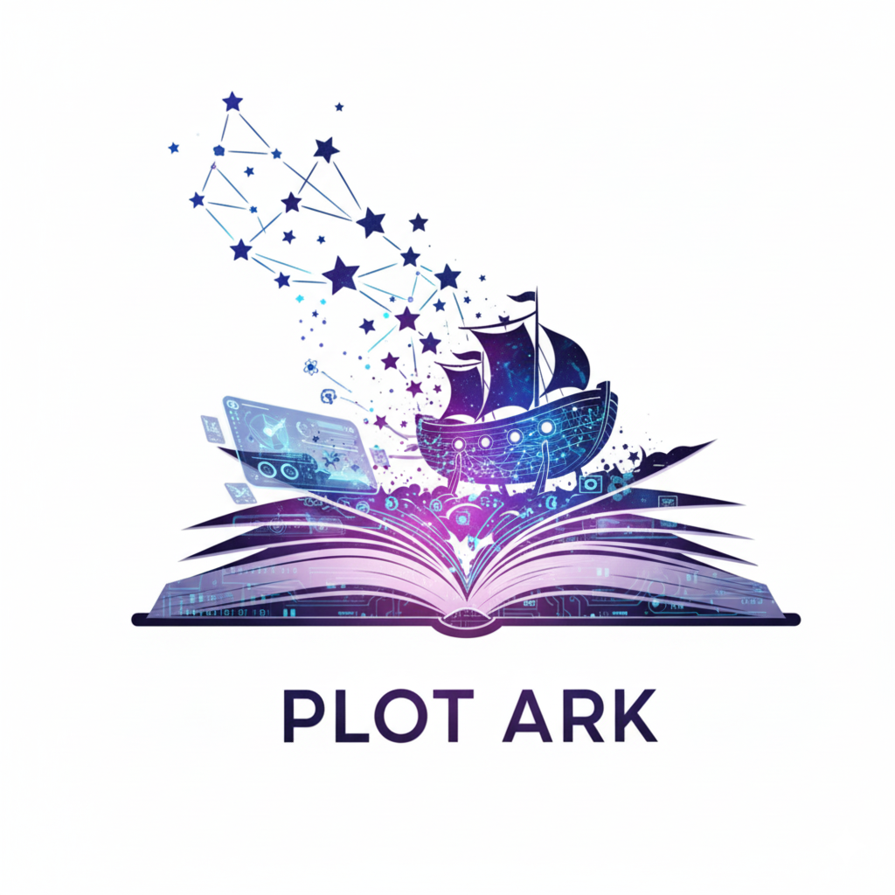
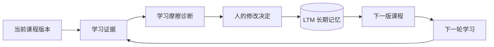

[English](README.md) | 中文

# Plot Ark — 观察 · 记忆 · 改进

[](https://www.gnu.org/licenses/agpl-3.0)
[](https://github.com/Schlaflied/Plot-Ark/stargazers)
[](https://github.com/Schlaflied/Plot-Ark/forks)
[](https://docs.docker.com/compose/)
[](https://www.python.org/)
[](https://flask.palletsprojects.com/)
[](https://react.dev/)
[](https://www.postgresql.org/)
[](https://redis.io/)
[](https://github.com/HKUDS/LightRAG)
[](https://xapi.com/)
[](https://tavily.com/)
[](docs/ACADEMIC.md)
[](https://www.imsglobal.org/)
[](https://github.com/Jenqyang/Awesome-AI-Agents)
[](https://github.com/aden-hive/hive)
[](https://github.com/aden-hive/hive/pulls?q=author%3ASchlaflied)

<p align="center">
  
</p>

<h3 align="center">
  👉 <a href="https://schlaflied.github.io/Plot-Ark/">访问精美的互动式官方主页</a> 👈
</h3>

**Plot Ark 是一套开源的课程改进长期记忆系统。它把每一版课程、促成修改的学习证据、人的最终决定，以及下一轮学习结果连接起来。**

大多数学习平台只能展示一次结果：完成率、学习时长、分数或反馈。Plot Ark 想回答的是后面那个更重要的问题：

> **我们改了课程。它后来真的变好了吗？**

Plot Ark 会在多轮分析之间保存完整线索：

1. 收集课程结构、学习行为与学习者反馈；
2. 找出学习摩擦集中在哪里；
3. 由人接受、拒绝或调整修改建议；
4. 将证据与决定存入长期记忆（LTM）；
5. 在下一版课程和下一轮学习数据出现后，与之前的结果进行比较。



### 两个工作区，同一个改进循环

| | Academic 高校版 | Enterprise 企业 L&D 版 |
|---|---|---|
| **核心问题** | 学生卡在哪里，课程应该怎么改？ | 培训在哪些地方流失学习者，下一版应该修什么？ |
| **角色** | Professor / Student | Admin / User |
| **常见输入** | 教学大纲、课程资料、xAPI 行为、概念标注、学生反馈 | SCORM/PDF/PPTX/DOCX 资料、LMS CSV/XLSX 报表、Learner Pulse；xAPI 可选 |
| **证据层级** | 学生私密自见 + 隐私安全的班级分析 | 群组级诊断，不对员工个人排名 |
| **人的控制** | 教师审核课程修改建议 | L&D 负责人审核培训修改建议 |
| **长期记忆** | 保存跨学期的课程分析与修改记录 | 使用同一套 LTM 比较培训版本，并为以后连接业务结果保留基础 |
| **当前状态** | 后端与界面已经形成完整闭环 | 产品预览（界面使用合成数据）。后端摄取 API（SCORM/PDF/PPTX/DOCX、LMS CSV/XLSX）已有代码与测试，但尚未接入界面；基于上传数据的分析运行仍在开发中 |

高校版和企业版不是两套产品。它们共用同一个核心：**证据 → 诊断 → 人的决定 → LTM → 下一版本**。

---

## 进一步了解 Plot Ark

| 内容 | 包含什么 |
|---|---|
| [Academic 高校工作区](docs/ACADEMIC.zh.md) | 课程生成、xAPI 证据、LightRAG 知识图谱、学生自见、A2A 诊断、LTM 与教师审核修改 |
| [Enterprise 企业 L&D 工作区](docs/ENTERPRISE.zh.md) | LMS/HCM 旁路工作流、现实文件入口、Learner Pulse、隐私边界、当前预览和计划中的摄取后端 |
| [完整系统架构](ARCHITECTURE.zh.md) | 页面数据流、服务、数据库 Schema、隐私红线和项目结构 |
| [互动式官方主页](https://schlaflied.github.io/Plot-Ark/) | 产品视觉介绍与演示 |
| [版本发布记录](https://github.com/Schlaflied/Plot-Ark/releases) | 已发布版本与变更历史 |

---

## 🏗️ 架构
**系统架构**

```
┌───────────────────────────────────────────────────────────────────────────────────────────┐
│  前端 (React + TypeScript + Vite)                                                           │
│  ┌──────────┐ ┌──────────┐ ┌──────────┐ ┌───────────┐ ┌───────────────┐ ┌────────┐ ┌────┐│
│  │ Generate  │ │ Courses  │ │  Course  │ │ Knowledge │ │ Student Data  │ │Student │ │设置││
│  │   Page    │ │   Page   │ │   Page   │ │   Graph   │ │    Page       │ │Profile │ │教授││
│  └────┬─────┘ └────┬─────┘ └────┬─────┘ └─────┬─────┘ └──────┬────────┘ └───┬────┘ └──┬─┘│
│       │            │            │              │              │              │          │  │
│  components/ui/  components/generate/    components/analytics/    ModelSelection (共享) │  │
│  (Select, Input)   (SyllabusUpload)   (TrendChart, ReportSections, ...)                  │
│                         GraphViewer（2D 知识图谱 + 掌握度叠层）                             │
│                                              SSE 流式传输                                  │
└───────┼────────────┼────────────┼──────────────┼──────────────┼──────────┼──────────┼──────┘
        │            │            │              │              │          │          │
        ▼            ▼            ▼              ▼              ▼          ▼          ▼
┌───────────────────────────────────────────────────────────────────────────────────────────┐
│  后端 (Flask + Blueprints)                                                                  │
│  ├── app.py (~30 行，仅路由)             ├── config.py (18 模型 + 环境常量)                  │
│  ├── extensions.py (单例：AI、Redis 等)  ├── async_loop.py (后台异步循环)                    │
│  ├──────────────────────────────────────────────────────────────────────────────────────┐  │
│  │  routes/                                                                              │  │
│  │  ├── curriculum.py           生成 / 验架 / 展开 / 保存                                │  │
│  │  ├── curriculum_agent_routes 标记 / 建议 / 应用 / 撤销 / 变更                         │  │
│  │  ├── history.py              CRUD + 收藏 + DOCX 导出                                  │  │
│  │  ├── analytics.py            A2A SSE 分析 + PDF/DOCX/Excel 导出                       │  │
│  │  ├── xapi.py                 xAPI 语句 + Mock 数据种子                                │  │
│  │  ├── feedback.py             学生情绪反馈 + 评论收集                                   │  │
│  │  ├── profile.py              Profile CRUD + model_config + Fernet API Key 加密        │  │
│  │  ├── settings.py             教授设置（偏好、模型、Prompt 模板）                        │  │
│  │  ├── graph.py                知识图谱 + RAG 查询 + /courses 查询                      │  │
│  │  ├── annotations.py          KG 概念标注（confused / important / exam_focus）          │  │
│  │  ├── sources.py              Tavily 源预览                                            │  │
│  │  ├── syllabus.py             PDF/DOCX 解析 + 导入                                     │  │
│  │  └── materials.py            LightRAG 材料摄入                                        │  │
│  └──────────────────────────────────────────────────────────────────────────────────────┘  │
│  ┌─────────────────────────────┐  ┌────────────────────────────────────┐   │
│  │  agents/ (Hive 风格 A2A)    │  │  services/                         │   │
│  │  ├── base.py (BaseNode)     │  │  ├── research.py (Tavily)          │   │
│  │  ├── orchestrator.py        │  │  ├── file_parser.py                │   │
│  │  ├── behavior_analyst.py    │  │  ├── prompt_builder.py             │   │
│  │  ├── risk_detector.py       │  │  ├── xapi_generator.py (⚡ aware)  │   │
│  │  ├── content_optimizer.py   │  │  ├── report_exporter.py (facade)   │   │
│  │  ├── cohort_comparator.py   │  │  ├── chart_generator.py (+history) │   │
│  │  ├── kg_context_analyst.py  │  │  ├── ltm_writer.py (Cold layer)    │   │
│  │  └── curriculum_agent.py    │  │  ├── threshold_checker.py          │   │
│  │       SharedMemory (Redis)  │  │  ├── kg_mapper.py（3 层匹配）      │   │
│  └──────────┬──────────────────┘  │  └── export_{pdf,docx,excel}.py   │   │
│             │                     └─────────────┬──────────────────────┘   │
└─────────────┼───────────────────────────────────┼──────────────────────────┘
              │                                   │
              ▼                                   ▼
┌───────────────────────┐  ┌──────────┐  ┌──────────────┐  ┌──────────────┐
│  PostgreSQL            │  │  Redis   │  │   LightRAG   │  │  data/ltm/   │
│  ├── curricula         │  │ (🔴 Hot: │  │  GraphML KG  │  │  (🔵 Cold:   │
│  ├── xapi_statements   │  │  流水线  │  │  （Hot 层）  │  │   .md YAML   │
│  ├── concept_          │  │  运行时) │  │              │  │   归档快照)  │
│  │   annotations       │  │          │  │              │  │              │
│  └── 🟡 Warm:          │  │          │  │              │  │              │
│      快照 / mastery    │  │          │  │              │  │              │
└───────────────────────┘  └──────────┘  └──────────────┘  └──────────────┘
```

**完整项目流水线**


**LTM 三层架构**


**完整主动式循环**


📐 **完整架构、逐页数据流、数据库 Schema、红线与项目结构 → [ARCHITECTURE.zh.md](ARCHITECTURE.zh.md)**

---

## 🛠️ 技术栈

| 层级 | 技术 | 职责 |
|------|------|------|
| **前端** | React + TypeScript + Vite | 模块编辑器、A2A 仪表板、SSE 客户端、拖拽排序 |
| **后端** | Python + Flask Blueprints | 模块化路由 API（10 个 Blueprints + 6 个 Agents + 6 个 Services） |
| **AI** | OpenAI GPT-4o / Google Gemini | 内容生成与 A2A 分析（通过 `AI_PROVIDER` 可插拔）；A2A agents 纯 SQL——**分析零 LLM 成本** |
| **研究 Agent** | Tavily Search API | 生成前学术信源检索 |
| **数据库** | PostgreSQL | 课程、xAPI 语句、学生反馈、`course_analysis_snapshots`（LTM） |
| **缓存与内存**| Redis | 图谱查询缓存、学习者状态、A2A 共享内存（`a2a:{session}:{key}`） |
| **知识图谱** | LightRAG + networkx + react-force-graph-2d| 课程材料导入 → 交互式概念图谱 |
| **行为数据** | xAPI 风格语句 + 极简内置语句存储（非认证 LRS） | 语句采集 → Mock 数据引擎（4 种噪声级别）→ 教授分析面板 |
| **分析引擎** | A2A 多 Agent（Hive 风格，sql-only Phase 1） | 5 节点流水线：Orchestrator + 4 个并行 Agent；Token 追踪；LTM 快照 |
| **报告导出** | ReportLab + python-docx + openpyxl + matplotlib | PDF（Anthropic 风格封面）、DOCX、Excel；文件名含课程 slug + 噪声标签 |
| **课程导出** | PDF + Markdown（客户端）；DOCX（客户端，以 `.doc` 后缀保存 HTML） | 已实现。服务端存在 `POST /api/curriculum/export/docx` 接口，但界面的"导出 DOCX"按钮并未调用它。IMS Common Cartridge **开发中**（界面按钮仅为占位，后端尚无导出器） |
| **开发** | Docker Compose | 一键启动本地环境（前端 :5173，后端 :5000） |

---

## 🚀 快速开始

**前置条件：** Docker、OpenAI 或 Gemini API Key、Tavily API Key（tavily.com 免费层）

```bash
git clone https://github.com/Schlaflied/Plot-Ark.git
cd Plot-Ark

cp .env.example .env
# 设置 AI_PROVIDER=openai 或 AI_PROVIDER=gemini
# 填入对应的 API Key + TAVILY_API_KEY

docker compose up --build
```

| 服务 | 地址 |
|------|------|
| 前端 | http://localhost:5173 |
| 后端 | http://localhost:5000 |

登录页提供两个工作区：

- **Academic** — Professor / Student
- **Enterprise** — Admin / User

Enterprise 工作区附带合成数据，用于产品体验和 QA。当前文件选择器只执行前端格式、数量和大小校验；尚未把所选文件上传到后端或进行真实解析。


---

## 🕸️ 使用知识图谱

知识图谱功能支持上传课程材料（PDF、PPTX 或 DOCX），并将其可视化为交互式概念地图。

1. 点击顶部导航栏的 **Knowledge Graph** 标签
2. 在右侧 **Upload Materials** 面板中填写：
   - **Subject name**（必填）— 例如 "Organizational Behavior"
   - **Course code**（选填）— 例如 "ADMS 2400"
   - **Year**（必填）— 该课程所属学年
3. 将 PDF / PPTX / DOCX 文件拖入上传区域
4. 点击 **Build Graph** — 后台自动运行知识图谱构建（约 $0.10–0.30 / 每 10 个 PDF，gpt-4o-mini 计费）
5. 构建完成后，图谱自动出现在对应学年和课程标签下


---

## 🗺️ 路线图

- [x] KG ↔ Curriculum 概念映射 — 三层匹配引擎（词边界正则 + 缩写剥离 + 反向查找）
- [x] Knowledge Map 标签页 — 每模块显示 KG 概念定义 + 跨模块依赖关系
- [x] 概念掌握度追踪 — xAPI 动词 + 学生反馈 → `cohort_concept_mastery`；每次分析后自动同步
- [x] GraphViewer 掌握度叠加层 — 填充色=掌握度，描边色=知识层级；无数据概念统一灰色
- [x] KG 双向标注 — 学生标记困惑/重要；教授标记考试重点；匿名聚合生成困惑热力图
- [x] KG → Agentic Loop — `KGContextAnalystNode` 将逐概念困惑度% + 最困惑概念列表注入 CurriculumAgent 上下文
- [x] GraphViewer 角色分流 — 学生端（掌握度过滤 + 困惑社交信号）vs 教授端（高困惑热力图 + 考试重点）
- [x] xAPI ↔ KG 信号桥接 — KG 标注事件同步写入 xAPI statement（动词：flagged / noted）；信号完全统一
- [x] 学生画像 — 4 标签页画像：头像、学科选择器（5 大领域）、CP/OC 叙事锚点、进度颜色块
- [x] 一句话诊断 — 模板驱动概念差距指引 + "Jump to Module" 导航
- [x] AI 设置 — 自定义 Prompt 指令 + 可点击灵感库 + 自动保存
- [x] 多角色人设组 — 多组角色对 + 关系标签、性别、性格描述、关联课程
- [x] 多模型 Agent 团队 — 9 家 provider 的 18 个预设模型 + 自定义模型；★ 推荐标签、⚠ MoE 警告、动态 API Key
- [x] 教授设置门户 — 个人信息、学术偏好、模型默认值、Prompt 模板；全部自动保存
- [x] 按 Provider API Key — Fernet 加密存储、动态检测、掩码 GET 返回
- [x] 教授 Prompt 模板编辑器 — 数据库驱动的 Prompt 管理 + 版本控制 + 变量高亮
- [x] 第一周加固 — API Key 加密失败即拒绝保存、移除浏览器端密钥、主应用 CI
- [x] Enterprise L&D Preview — 工作区 Admin/User 登录分流、合成合规培训诊断、证据链、Learner Pulse 与 HITL 修改审核
- [x] 企业摄取基础 — 服务端项目/资料 API、安全的 SCORM 静态提取、CSV/XLSX 规范化、持久化与测试（`backend/services/enterprise_ingest.py`）；尚未接入企业版界面
- [x] 企业数据入口契约 — SCORM ZIP/PDF/PPTX/DOCX/XLSX/CSV 选择器与明确的前端数量/大小限制；xAPI 保持可选
- [x] LMS 导出映射预设 — Workday Learning、D2L Brightspace、Canvas 与 Moodle（含多版本 Moodle 迁移的来源标签）；自动匹配/手动覆盖，未匹配列始终展示、不会静默丢弃
- [x] Manager Follow-up Pulse + 前后测 Confidence Pulse — 新的企业证据来源，带回答质量检测、仅群组级报告与最小样本量隐私门槛
- [x] 设计期测量计划 — 按项目版本管理，与实际收集的证据对比并检测缺口
- [x] 评估层级摘要报告 — 按层级（反应/学习/行为/结果）给出大白话说明与数据质量提示，不含因果性措辞
- [x] 评估设计分诊 — 标记纯记忆型评估题，提出反思/应用/支架式替代方案
- [x] 反馈分诊 — 将开放式学员反馈聚类为话题，按独立学员数给出可配置的升级建议
- [x] 无障碍初筛（WCAG 2.1）— HTML/DOCX，明确声明不是合规认证
- [x] 可选本地模型模式 — `AI_PROVIDER=local` 将支持的步骤路由到 Ollama 兼容端点；失败即报错，绝不静默回退到托管模型
- [x] `refresh.mjs` — 证据驱动的课程刷新 CLI 原型（dry-run；快照 → 语义diff → 影响映射 → 变更简报 → 人工审批 → 审计留痕）
- [x] LTI 1.3 工具 MVP（Moodle）— OIDC 登录、launch、deep linking、角色映射；成绩回传（AGS）与多租户注册表留作后续
- [ ] 企业摄取 — 界面接入摄取 API、基于真实分析运行的证据覆盖率与修改简报导出
- [ ] 作业时间轴 + 截止日期计算器
- [ ] A2A Phase 2 — CurriculumAgent 接入 LLM（必须 dense 模型）；其余 Agent 保持 sql-only
- [ ] 渐进式摘要 — 学期级 LTM 摘要用于 LLM 上下文管理
- [ ] IMS Common Cartridge 导出 — 开发中（计划中，尚未实现）

---

## 📄 许可证

GNU Affero 通用公共许可证 v3.0 — 详见 [LICENSE](LICENSE)

- 个人使用、学术研究及开源项目免费
- 修改版本必须以相同许可证开源
- 网络部署要求你的产品同样开源
- 商业授权 — 请提交 GitHub Issue 联系

---

## 收录

- 🌟 [Awesome-AI-Agents](https://github.com/Jenqyang/Awesome-AI-Agents) — 主动式 EdTech 课程引擎

---

## ⭐ Star 历史

<a href="https://www.star-history.com/#Schlaflied/Plot-Ark&Date">
 <picture>
   <source media="(prefers-color-scheme: dark)" srcset="https://api.star-history.com/svg?repos=Schlaflied/Plot-Ark&type=Date&theme=dark" />
   <source media="(prefers-color-scheme: light)" srcset="https://api.star-history.com/svg?repos=Schlaflied/Plot-Ark&type=Date" />
   
 </picture>
</a>

---

## 🙏 致谢

架构灵感来源于 [Hive](https://github.com/aden-hive/hive)（YC 投资的 AI Agent 基础设施）——节点流水线、共享记忆与进化循环模式为主动式课程引擎的设计提供了重要参考。

知识图谱层由 [LightRAG](https://github.com/HKUDS/LightRAG)（HKUDS）驱动——实现跨课程材料的增量知识图谱构建与前置知识推断。

两阶段生成流水线设计灵感来源于 [OpenMAIC](https://github.com/THU-MAIC/OpenMAIC)（清华大学）——先生成大纲骨架、再逐模块展开的模式为 Plot Ark 的课程骨架生成方法提供了参考。

以 [Claude](https://claude.ai)（Anthropic）为 AI 结对编程伙伴构建完成。

特别感谢两位首席质量保证官，全程监督每一个深夜 coding session —— **Icy**（冰糖，白猫）与**雪梨**（三花猫）：

<p align="center">
  
</p>

---

<div align="center">

[报告 Bug](https://github.com/Schlaflied/Plot-Ark/issues) · [请求功能](https://github.com/Schlaflied/Plot-Ark/issues)

**如果这个项目对你有用，请给个 Star。**

</div>
