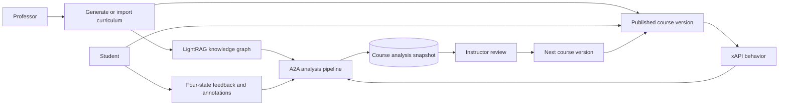

# Plot Ark Academic Workspace

[Back to README](../README.md) | [中文](ACADEMIC.zh.md)

The Academic workspace is the full course-improvement loop for instructors and students. It combines curriculum creation, learning evidence, human-governed revision, and longitudinal memory.

## What it answers

> Where are students struggling, what should change, and did that change help the next time the course ran?

## Architecture

## Main capabilities

### 1. Build the course

- Generate a curriculum from researched sources before content expansion.
- Import PDF or DOCX syllabi.
- Constrain structure with Bloom's Taxonomy, i+1 progression, and cognitive-load rules.
- Edit modules, objectives, readings, assessments, ordering, and the course narrative.

### 2. Map what the course teaches

- Ingest PDF, PPTX, and DOCX materials into a LightRAG knowledge graph.
- Visualize concepts, prerequisite relationships, and connections across modules.
- Overlay cohort mastery, learner attention, and concept annotations without turning them into a leaderboard.

### 3. Observe learning evidence

- Capture xAPI-style statements through the included minimal statement endpoints (not a certified LRS).
- Keep four learner states distinct: understood, partly understood, difficulty not localized, and not reviewed.
- Analyze behavior, risk signals, content friction, and cohort differences with a five-node A2A pipeline.
- Stream analysis progress to the interface through SSE.

### 4. Remember and improve

- Persist every analysis run in PostgreSQL `course_analysis_snapshots`.
- Use Redis as pipeline memory and versioned Markdown as the cold archive.
- Turn evidence into three levels of curriculum suggestions.
- Let instructors apply, reject, revise, or undo changes with a before/after view.
- Compare later runs with earlier snapshots instead of treating every report as a fresh start.

### 5. Give learners a private mirror

- Show a learner their own attention footprint and learning rhythm.
- Provide gentle concept-gap navigation without numeric rankings.
- Let learners confirm or reject pattern statements in the Look Back Card.
- Keep student profiles and self-view verdicts unavailable to instructor endpoints.

### 6. Export and integrate

- Export curricula as PDF, DOCX, or Markdown. IMS Common Cartridge export is in development (not yet implemented).
- Export analysis reports as PDF, DOCX, or Excel.
- Use configurable OpenAI-compatible models while encrypting provider API keys on the backend.

## Roles

| Role | Access |
|---|---|
| **Professor** | Course generation, knowledge graph, cohort analytics, revision review, reports, and settings |
| **Student** | Courses, feedback, private self-view, learning profile, and personal AI settings |

## Current status

The Academic workspace has a functional React UI and Flask backend, with PostgreSQL, Redis, LightRAG, xAPI ingestion, analysis snapshots, human-in-the-loop revisions, and exports available in the Docker development environment.

For implementation details, see [ARCHITECTURE.md](../ARCHITECTURE.md).
