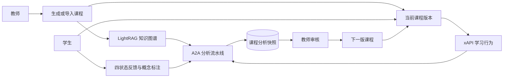

# Plot Ark Academic 高校工作区

[返回 README](../README.zh.md) | [English](ACADEMIC.md)

Academic 工作区是一套面向教师和学生的完整课程改进循环：创建课程、收集学习证据、由人决定是否修改，并用长期记忆比较后续结果。

## 它回答什么问题

> 学生卡在哪里、课程应该怎么改，以及这次修改在下一轮教学中是否真的有效？

## 架构

## 主要功能

### 1. 创建课程

- 先检索真实来源，再生成课程结构与内容。
- 从 PDF 或 DOCX 教学大纲导入课程信息。
- 使用布鲁姆认知分类法、i+1 难度递进和认知负荷规则约束结构。
- 编辑模块、学习目标、阅读材料、作业、顺序和课程叙事。

### 2. 看清课程教了什么

- 将 PDF、PPTX 和 DOCX 资料摄取为 LightRAG 知识图谱。
- 展示概念、先修关系以及跨模块连接。
- 叠加班级掌握度、学生注意力与概念标注，但不把它们变成排行榜。

### 3. 收集学习证据

- 通过内置的极简语句接口收集 xAPI 风格行为语句（非认证 LRS）。
- 区分四种学习状态：理解、部分理解、无法定位困难、尚未学习。
- 由五节点 A2A 流水线分析行为、风险信号、内容摩擦和群组差异。
- 通过 SSE 在界面中实时展示分析进度。

### 4. 记住并改进

- 将每次分析保存到 PostgreSQL `course_analysis_snapshots`。
- Redis 保存流水线上下文，版本化 Markdown 作为冷归档。
- 将证据转成三个层级的课程修改建议。
- 教师可以查看修改前后对比，并选择应用、拒绝、调整或撤销。
- 后续分析会与历史快照比较，而不是每次都从零开始。

### 5. 给学生一面私密的镜子

- 让学生查看自己的注意力足迹与学习节律。
- 提供不含分数和排名的概念差距指引。
- 学生可以在回望卡中确认或否决系统总结的学习模式。
- 教师端点不能读取学生画像和自见判断。

### 6. 导出与集成

- 课程可导出为 PDF、DOCX 或 Markdown。IMS Common Cartridge 导出开发中（尚未实现）。
- 分析报告可导出为 PDF、DOCX 或 Excel。
- 支持 OpenAI 兼容模型，并在后端加密保存各 provider 的 API Key。

## 角色

| 角色 | 可以使用的功能 |
|---|---|
| **Professor** | 课程生成、知识图谱、班级分析、修改审核、报告和设置 |
| **Student** | 课程、反馈、私密自见、学习画像和个人 AI 设置 |

## 当前状态

Academic 工作区已有可运行的 React 界面与 Flask 后端。Docker 开发环境包含 PostgreSQL、Redis、LightRAG、xAPI 摄取、分析快照、人在回路修改和报告导出。

实现细节参见 [ARCHITECTURE.zh.md](../ARCHITECTURE.zh.md)。
