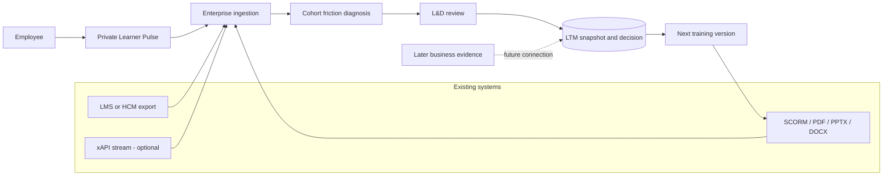

# Plot Ark Enterprise L&D Workspace

[Back to README](../README.md) | [中文](ENTERPRISE.zh.md)

The Enterprise workspace adapts Plot Ark's course-improvement memory to workplace learning. It is designed to sit beside an existing LMS or HCM rather than replace one.

## What it answers

> Where does training lose people, what evidence supports that diagnosis, and what should the next content version change?

## Target architecture

## How it differs from Academic

| | Academic | Enterprise L&D |
|---|---|---|
| **Starting point** | A course can be generated and delivered inside Plot Ark | Training usually already exists in an LMS, SCORM package, document, or spreadsheet |
| **Behavior source** | Native xAPI events and student feedback | LMS exports and Learner Pulse first; xAPI is optional |
| **Decision owner** | Instructor | L&D, compliance, enablement, or training owner |
| **Analysis level** | Learner self-view plus cohort evidence | Cohort and content evidence; no employee ranking |
| **Desired outcome** | A better next teaching cycle | A better next training version, with a path toward operational or business evidence |
| **Integration stance** | Full learning workspace | Add-on observability layer beside LMS/HCM |

## Available in the current preview

- Separate Enterprise login with Admin and User roles.
- Synthetic compliance-training program and clearly labelled demo metrics.
- Admin diagnosis console with completion, time, content issues, and evidence coverage.
- Evidence cards for training content, LMS reports, and Learner Pulse.
- Human review of revision recommendations.
- A private, non-ranking four-state Learner Pulse for employees.
- Client-side upload validation for SCORM ZIP, PDF, PPTX, DOCX, XLSX, and CSV.

## Not implemented yet

The current Enterprise workspace is a product preview, not a production ingestion service. The following remain roadmap work:

- secure server-side file upload and persistence;
- static SCORM manifest and content extraction;
- CSV/XLSX field mapping for different LMS exports;
- real enterprise analysis runs and LTM snapshots;
- multi-tenant authentication and organization boundaries;
- revision-brief export and downstream business-metric connectors.

## Why xAPI is optional

Many workplace systems cannot produce usable xAPI data. Plot Ark therefore starts with evidence that L&D teams already have: course files, completion exports, time data, assessment results, and a lightweight learner pulse. xAPI can strengthen the evidence when available, but it is not the entry requirement.

## Privacy boundary

Enterprise analysis is intended to diagnose training content, not score employees. The Learner Pulse separates “not reviewed” from “did not understand,” and findings should remain cohort-level unless an organization establishes a legitimate, transparent reason for individual intervention.

For the shared backend architecture, see [ARCHITECTURE.md](../ARCHITECTURE.md).
