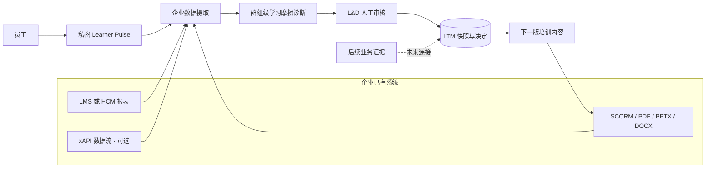

# Plot Ark Enterprise 企业 L&D 工作区

[返回 README](../README.zh.md) | [English](ENTERPRISE.md)

Enterprise 工作区把 Plot Ark 的课程改进长期记忆迁移到职场学习。它不是为了替换现有 LMS 或 HCM，而是作为旁边的一层课程可观测与改进工具。

## 它回答什么问题

> 培训在哪些地方流失学习者、这个判断有什么证据，以及下一版内容应该修改什么？

## 目标架构

## 它与高校版哪里不同

| | Academic 高校版 | Enterprise 企业 L&D 版 |
|---|---|---|
| **起点** | 可以直接在 Plot Ark 中生成并交付课程 | 培训通常已经存在于 LMS、SCORM、文档或表格中 |
| **行为来源** | 原生 xAPI 事件与学生反馈 | 优先使用 LMS 报表和 Learner Pulse；xAPI 可选 |
| **决定者** | 教师 | L&D、合规、销售赋能或培训负责人 |
| **分析层级** | 学生私密自见 + 班级证据 | 群组与内容证据，不对员工个人排名 |
| **希望得到的结果** | 下一轮教学更好 | 下一版培训更好，并为以后连接业务结果留下接口 |
| **集成方式** | 完整学习工作区 | 放在 LMS/HCM 旁边的可观测插件层 |

## 当前预览版已经有的功能

- 独立 Enterprise 登录入口，包含 Admin 和 User 两种角色。
- 合成的合规培训项目与明确标注的演示指标。
- Admin 诊断台：完成率、学习时间、内容问题和证据覆盖率。
- 培训资料、LMS 报表和 Learner Pulse 三类证据入口。
- 由人审核课程修改建议。
- 面向员工的私密、无排名四状态 Learner Pulse。
- 对 SCORM ZIP、PDF、PPTX、DOCX、XLSX 和 CSV 执行浏览器端上传校验。

## 目前还没有实现的部分

当前 Enterprise 工作区是产品预览，不是可投入生产的数据摄取服务。以下内容仍在路线图中：

- 安全的服务端文件上传和持久化；
- SCORM manifest 与静态内容提取；
- 不同 LMS 导出 CSV/XLSX 的字段映射；
- 真实企业分析运行与 LTM 快照；
- 多租户身份认证和组织边界；
- 修改简报导出与业务指标连接器。

## 为什么 xAPI 是可选项

许多企业系统不能提供可用的 xAPI 数据。因此 Plot Ark 先从 L&D 团队已经拥有的证据开始：课程文件、完成率报表、学习时长、考核结果和轻量 Learner Pulse。存在 xAPI 时可以增强证据，但它不是使用门槛。

## 隐私边界

企业分析的目标是诊断培训内容，而不是给员工打分。Learner Pulse 会把“尚未学习”和“没有理解”分开；除非组织有合法、透明的个人干预理由，否则诊断应保持在群组层级。

共用后端架构参见 [ARCHITECTURE.zh.md](../ARCHITECTURE.zh.md)。
